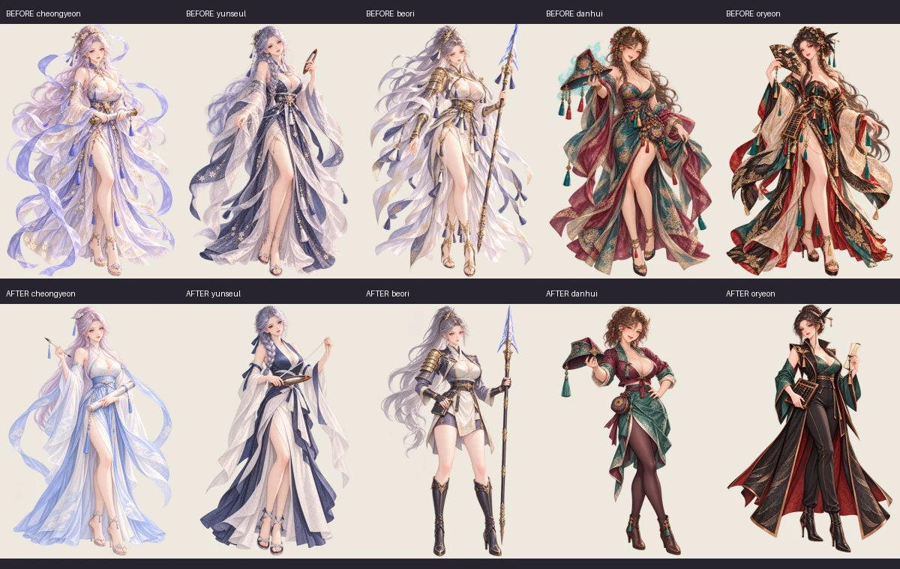
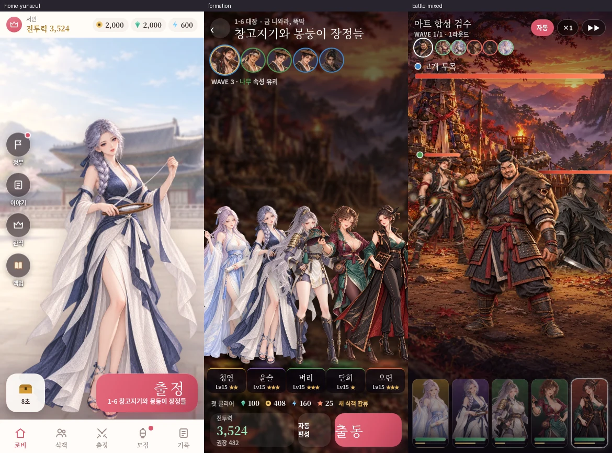

# 왕도 아트 개선 기록

2026-10-26 작업본 기준으로 그림 42장을 적용했다. 기존 그림 32장을 교체하고 전장용 적 전신 10장을 추가해 `public/art/`의 WebP는 228개에서 238개가 됐다. 게임 밸런스·성장 규칙·이야기 대사는 바꾸지 않았다. 식객 데이터에서는 그림 제작용 `art` 설명만 수정했다.

이 기록은 로컬 작업본과 로컬 검증의 완료 범위다. GitHub Pages 운영 배포 완료나 전체 캠페인 플레이 완료를 뜻하지 않는다.

## 식객 24장

청연·윤슬·벼리·단희·오련은 각각 카드·전신·인연 3단계·인연 5단계, 총 20장을 교체했다. 현재의 부드러운 반실사 채색과 성인 캐릭터의 매력을 유지하면서 옷의 길이·소매·머리 형태·도구와 손의 행동을 구분했다.

| 식객 | 적용한 구별점 | 교체한 경로 |
| --- | --- | --- |
| 청연 | 하늘색·상아의 넓은 소매와 가벼운 겉옷, 붓·문서통을 든 차분한 서기관 | `card/cheongyeon.webp`, `full/cheongyeon.webp`, `cg/cheongyeon-3.webp`, `cg/cheongyeon-5.webp` |
| 윤슬 | 남색·상아의 작업치마, 굵은 옆땋은 머리, 나무 북과 한 줄의 실을 다루는 직녀 | `card/yunseul.webp`, `full/yunseul.webp`, `cg/yunseul-3.webp`, `cg/yunseul-5.webp` |
| 벼리 | 짧은 집행 튜닉·재킷·장화와 긴 창, 상아·먹색에 옅은 보라·금색 포인트 | `card/beori.webp`, `full/beori.webp`, `cg/beori-3.webp`, `cg/beori-5.webp` |
| 단희 | 옥색·자두색의 짧은 겹옷과 감투, 장난스러운 감투 상인의 자세 | `card/danhui.webp`, `full/danhui.webp`, `cg/danhui-3.webp`, `cg/danhui-5.webp` |
| 오련 | 검정·구리의 긴 맞춤 겉옷과 높은 깃, 주판·거래 문서를 든 행수 | `card/oryeon.webp`, `full/oryeon.webp`, `cg/oryeon-3.webp`, `cg/oryeon-5.webp` |

경로는 모두 `public/art/` 아래다. 인연 CG도 각 식객의 대본과 역할 소품에 연결해 다시 제작했다. 무영·월하는 카드와 전신 각 2장, 합계 4장의 기본 표정을 수정해 무관의 단호함과 차사의 침착함을 구분했다. 두 식객의 인연 CG는 기존 그림을 유지한다.

아래 비교는 위가 기존 전신, 아래가 교체한 전신이다.

## 전장용 적 전신 10장

기존 적 초상은 보존하고 별도 `public/art/enemy/`에 800×1200 RGBA 전신을 추가했다. 머리·무기·발이 캔버스 안에 들어오도록 제작하고 전투 화면에서 이 전신을 우선 사용하게 연결했다.

| 종류 | 추가한 파일 |
| --- | --- |
| 대장 5종 | `enemy/boss/alley.webp`, `enemy/boss/backhill.webp`, `enemy/boss/dobak.webp`, `enemy/boss/ferry.webp`, `enemy/boss/noegong.webp` |
| 졸개 5종 | `enemy/grunt/alley.webp`, `enemy/grunt/backhill.webp`, `enemy/grunt/backhill-2.webp`, `enemy/grunt/ferry.webp`, `enemy/grunt/underworld.webp` |

전신 파일이 없는 상대는 기존 초상을 계속 사용한다. 전신이 있는 적과 초상만 있는 적이 같은 전투에 나와도 각자 준비된 그림을 쓰도록 했다. 아직 전장용 전신을 추가하지 않은 나머지 적 42종은 후속 제작 범위이며, 이번 10종이 전체 적 전신화 완료를 뜻하지 않는다.

## 배경 3장과 이야기 그림 5장

| 구분 | 교체 경로 | 목적 |
| --- | --- | --- |
| 배경 | `bg/market.webp`, `bg/night.webp` | 시장·밤 장면의 공간과 명도 정리 |
| 전투 배경 | `battle/pleasure.webp` | 중앙의 과한 금빛 반사를 줄이고 적이 설 바닥과 윤곽의 여백 확보 |
| 이야기 | `scene/s2e1-desk.webp`, `scene/s3e1-thunder.webp`, `scene/s3e2-ladder.webp`, `scene/s3e3-loom.webp`, `scene/s3e4-bridge.webp` | 해당 이야기의 금표·집달관·구름 사다리·베틀·오작교 장면에 맞춘 그림 교체 |

위 경로도 `public/art/` 아래다. 그림을 실제로 사용하는 대사 묶음에서 장면 제작 설명을 만들도록 연결했으며 이야기 텍스트 자체는 수정하지 않았다.

## 제작 기준과 도구

- [CHARACTER_GUIDE.md](CHARACTER_GUIDE.md)에 16명별 얼굴·표정·색·실루엣·소품 기준을 정리하고 현재 그림과 충돌하던 초기 주문을 대체했다. [ART_DIRECTION.md](ART_DIRECTION.md)는 실제 교체한 5명과 후속 제작 방향을 구분한다.
- `src/data/art.ts`에 종류별 출력 크기·투명도 규격과 캐릭터 동일성 참조를, `src/data/art-direction.ts`에 실제 인연·이야기·적 데이터와 연결된 제작 대상을 정의했다.
- `scripts/gen-art.ts`는 화풍 참조와 인물·소품 동일성 참조를 구분하고 부분 편집·작업 미리보기·출력 검증을 지원한다. 참조 누락, 잘못된 구도, 불투명한 전신 출력을 조용히 채택하지 않도록 했다.
- 투명 원화는 밝은 바탕·짙은 바탕에 합성해 확인한다. 일부 뷰어가 알파 0 픽셀의 숨은 RGB를 보여 주는 현상은 실제 누끼 결함으로 취급하지 않는다.

## 확인한 범위

타입 검사와 프로덕션 빌드가 통과했고, 테스트 6개 파일의 80개 검사가 통과했다. 제작 명세·참조·부분 편집·전장용 전신 경로 등에 대한 회귀 검사를 포함한다.

390×844 로컬 브라우저에서 준비한 게임 상태를 사용해 다음 7개 화면을 캡처했다. 캡처는 로컬 QA용이며 새로 시작해 전체 진행을 플레이한 결과가 아니다.

| 화면 | 로컬 증거 파일 |
| --- | --- |
| 윤슬 로비 | `/workspace/art-work/screens/home-yunseul.png` |
| 벼리 로비 | `/workspace/art-work/screens/home-beori.png` |
| 오련 로비 | `/workspace/art-work/screens/home-oryeon.png` |
| 식객 목록 | `/workspace/art-work/screens/collection.png` |
| 편성 | `/workspace/art-work/screens/formation.png` |
| 전신·기존 초상 혼합 전투 | `/workspace/art-work/screens/battle-mixed.png` |
| 교체한 유흥가 배경의 전투 | `/workspace/art-work/screens/battle-pleasure.png` |

해당 로컬 브라우저 실행에서 페이지 JavaScript 예외는 수집되지 않았다. 혼합 전투에서는 전신 2명과 기존 초상 1명이 함께 표시됐고, 불러온 전신의 원본 크기 800×1200을 확인했다. 모든 캠페인 스테이지·모든 인연 장면·모든 기기 크기의 표시까지 확인한 것은 아니다.

로비에서 가로로 뻗은 손이 잘리던 배치를 수정해 전신을 화면 폭 안에 맞췄고, 수정 후 로비와 편성을 다시 확인했다.

## 남아 있는 범위

우선 5명 외의 식객 9명, 무영·월하의 인연 CG, 이번에 고르지 않은 이야기·배경은 기존 그림을 유지한다. 16명 디자인표와 인연 장면 방향은 이 그림을 나중에 손볼 때 쓰는 기준이며 이번 교체 목록에 포함되지 않는다. 나머지 적 42종의 전신 제작도 필요할 때 이어갈 수 있도록 기존 초상 대체 동작을 보존했다.
